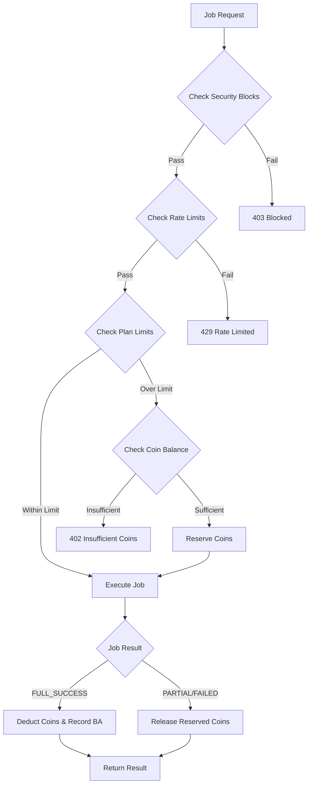

# 🎯 UNIFIED BILLING SYSTEM — CANONICAL SPECIFICATION

**Status**: Single Source of Truth  
**Last Updated**: 2026-01-11  
**Purpose**: Complete authoritative definition of billing, coins, BA, rate limiting, and access control for HSAFX_APP

---

## TABLE OF CONTENTS

1. [Core Billing Definitions](#1-core-billing-definitions)
2. [Tool Class Policies](#2-tool-class-policies)
3. [Subscription Plans & Pricing](#3-subscription-plans--pricing)
4. [Rate Limiting & Quota Model](#4-rate-limiting--quota-model)
5. [Job Execution Model](#5-job-execution-model)
6. [Coin Deduction Flow](#6-coin-deduction-flow)
7. [Fallback & Edge Cases](#7-fallback--edge-cases)
8. [Ad-Watching Coin System](#8-ad-watching-coin-system)
9. [Anonymous User Limits](#9-anonymous-user-limits)
10. [Security & Bot Mitigation](#10-security--bot-mitigation)
11. [Access Control & Feature Permissions](#11-access-control--feature-permissions)
12. [Resource Tier Limits](#12-resource-tier-limits)
13. [Database Schema Summary](#13-database-schema-summary)
14. [Admin Controls](#14-admin-controls)

---

## 1. CORE BILLING DEFINITIONS

### 1.1 Billable Action (BA)

**Invariant Definition:**
> **1 BA = 1 terminal FULL_SUCCESS job/output**

- A BA is charged **only when** a job reaches `FULL_SUCCESS` status
- Partial results, previews, cached hits, and failed jobs are **NOT billable**
- Retries do **not** add additional BA charges (idempotency key enforcement)
- Only the **first** `FULL_SUCCESS` for a given idempotency key is billable

**Key Rules:**
- Failed, blocked, cancelled, preview, or partial jobs → **NOT billable**
- All requests remain **rate-limited** regardless of billing
- BA weight is **identical** for async and sync execution

### 1.2 BA Weight System

Tool classes apply **BA weights** for bundled billing:

```
ba_charged = success_count × ba_weight
```

**Common BA Weights:**
- `ba_weight = 1.0` → Standard billing (1 success = 1 BA)
- `ba_weight = 0.5` → Bundled billing (2 successes = 1 BA)
- `ba_weight = 0.2` → Bundled billing (5 successes = 1 BA)
- `ba_weight = 0.1` → Bundled billing (10 successes = 1 BA)

BA weights are defined per **tool_class** in the `tool_class_policy` configuration.

### 1.3 Coin System (SIMPLIFIED)

**New Formula (Removed coin_per_ba multiplier):**

```typescript
coins_charged = Math.ceil(ba_charged × (1 - discount_percent / 100))
```

**Calculation Order:**
1. Calculate `ba_charged` using ba_weight: `success_count × ba_weight`
2. Apply plan discount: `ba_charged × (1 - discount_percent/100)`
3. Ceiling function rounds up to nearest integer
4. **NO minimum coin enforcement** - fractional BA with high discounts can result in 0 coins

**Examples:**

```typescript
// Example 1: Text Transform (5 successes, ba_weight=0.2, Free Plan 0% discount)
ba_charged = 5 × 0.2 = 1.0 BA
coins = ceil(1.0 × (1 - 0/100)) = ceil(1.0) = 1 coin

// Example 2: Calculator (10 successes, ba_weight=0.1, Pro Plan 20% discount)
ba_charged = 10 × 0.1 = 1.0 BA
coins = ceil(1.0 × (1 - 20/100)) = ceil(0.8) = 1 coin

// Example 3: Single Calculator (1 success, ba_weight=0.1, Advance Plan 40% discount)
ba_charged = 1 × 0.1 = 0.1 BA
coins = ceil(0.1 × (1 - 40/100)) = ceil(0.06) = 1 coin

// Example 4: Single Calculator (1 success, ba_weight=0.1, Advance Plan 90% discount - hypothetical)
ba_charged = 1 × 0.1 = 0.1 BA
coins = ceil(0.1 × (1 - 90/100)) = ceil(0.01) = 1 coin

// Example 5: Image Conversion (1 success, ba_weight=1.0, Free Plan 0% discount)
ba_charged = 1 × 1.0 = 1.0 BA
coins = ceil(1.0 × (1 - 0/100)) = ceil(1.0) = 1 coin

// Example 6: Video Conversion (1 success, ba_weight=1.0, Advance Plan 40% discount)
ba_charged = 1 × 1.0 = 1.0 BA
coins = ceil(1.0 × (1 - 40/100)) = ceil(0.6) = 1 coin
```

**Key Changes from Previous System:**
- ❌ Removed `coin_per_ba` multiplier
- ❌ Removed `max(1, ...)` minimum enforcement
- ✅ Direct BA-to-coin conversion
- ✅ Only discount applied
- ✅ Ceiling function ensures whole coins
- ✅ Simpler, more transparent pricing

---

## 2. TOOL CLASS POLICIES

Each tool class defines its billing and execution behavior:

| Tool Class                | BA Weight | Successes per BA | Execution Mode | Example Tools                      |
|---------------------------|-----------|------------------|----------------|------------------------------------|
| `text_transform`          | 0.2       | 5                | sync           | Case Convert, Trim, Replace        |
| `text_generator`          | 1.0       | 1                | sync           | Lorem Ipsum, Password Gen          |
| `calculator`              | 0.1       | 10               | sync           | Age, BMI, Percentage               |
| `structured_conversion`   | 0.2       | 5                | sync           | JSON→CSV, XML→JSON                 |
| `image_converter`         | 1.0       | 1                | async          | PNG→JPG, Resize, Compress          |
| `video_converter`         | 1.0       | 1                | async          | MP4→AVI, Trim, Compress            |
| `audio_converter`         | 1.0       | 1                | async          | MP3→WAV, Normalize                 |
| `document_converter`      | 1.0       | 1                | async          | PDF→DOCX, Merge PDF                |
| `file_converter`          | 1.0       | 1                | async          | Archive, Split, Join               |
| `diagram_generator`       | 1.0       | 1                | async          | Mermaid, PlantUML, Flowchart       |
| `data_visualization`      | 1.0       | 1                | sync/async     | Chart.js, D3 outputs               |
| `advanced_processor`      | 1.0       | 1                | async          | OCR, Speech-to-Text, AI tools      |

### 2.1 Execution Mode Rules

**Async Required (`async_required = true`):**
- All file/media/document/video/audio conversions
- Any tool with output >5MB expected
- Tools requiring >10s processing time
- Tools using external heavy compute (FFmpeg, ImageMagick, Ghostscript)

**Sync Allowed (`async_required = false`):**
- Text-only transformations with <5KB payload
- Calculators with instant compute
- Small structured data conversions (<100KB)

**Billing Invariant:** BA weight and coin charges are **identical** for async and sync executions.

### 2.2 Detailed Tool Class Descriptions

#### 🟦 A. TEXT TRANSFORMS

**Tool Class**: `text_transform`  
**BA Weight**: 0.2 (5 completions = 1 BA)  
**Execution Mode**: sync

Applies to:
- Case converters (upper, lower, title, camel, snake, kebab)
- Text wrappers and formatters
- Unicode transforms
- Cleanup utilities (trim, normalize)
- Base64/URL encoding/decoding

---

#### 🔢 B. CALCULATORS

**Tool Class**: `calculator`  
**BA Weight**: 0.1 (10 completions = 1 BA)  
**Execution Mode**: sync

Examples:
- Age calculator
- BMI calculator
- Percentage calculator
- Date/time calculators
- Unit converters (small payload)
- GPA calculator
- Zakat calculator
- Islamic Inheritance calculator

---

#### 🧩 C. STRUCTURED DATA CONVERSION

**Tool Class**: `structured_conversion`  
**BA Weight**: 0.2 (5 completions = 1 BA)  
**Execution Mode**: sync

Examples:
- JSON ⇄ YAML
- JSON ⇄ CSV (inline, <100KB)
- XML ⇄ JSON
- Schema ⇄ Types (text output only)

---

#### 📄 D. FILE-BASED CONVERSIONS

##### Image Converter
**Tool Class**: `image_converter`  
**BA Weight**: 1.0 (1 completion = 1 BA)  
**Execution Mode**: async (required)

Examples: PNG→JPG, WEBP→PNG, Resize, Compress

##### Video Converter
**Tool Class**: `video_converter`  
**BA Weight**: 1.0  
**Execution Mode**: async (required)

Examples: MP4→AVI, Trim Video, Compress

##### Audio Converter
**Tool Class**: `audio_converter`  
**BA Weight**: 1.0  
**Execution Mode**: async (required)

Examples: MP3→WAV, Audio Normalize, Trim Audio

##### Document Converter
**Tool Class**: `document_converter`  
**BA Weight**: 1.0  
**Execution Mode**: async (required)

Examples: PDF→DOCX, Merge PDF, Split PDF

##### File Operations
**Tool Class**: `file_converter`  
**BA Weight**: 1.0  
**Execution Mode**: async (required)

Examples: Create Archive, Split File, Join Files

> **Note**: File upload alone is **never billable**. Only successful output generation counts.

---

#### 🗺️ E. DIAGRAM & VISUALIZATION TOOLS

**Tool Class**: `diagram_generator`  
**BA Weight**: 1.0  
**Execution Mode**: async (required)

Examples:
- Mermaid diagrams
- PlantUML
- DBML diagrams
- Flowcharts
- File structure trees

**Billing Modes:**
- **Usage-time based**: 1 BA per active hour (editor usage)
- **Export-based**: 1 BA per export (PNG / SVG / PDF)

---

#### 🔧 F. ADVANCED PROCESSING

**Tool Class**: `advanced_processor`  
**BA Weight**: 1.0  
**Execution Mode**: async (required)

Examples:
- OCR (image to text)
- Speech-to-Text
- AI-powered tools
- Complex data processing

---

## 3. SUBSCRIPTION PLANS & PRICING

### 3.1 Canonical Plan Names

**B2C Plans:**

| Database Code | Friendly Label | Display Name            | Monthly Fee | Yearly Fee | Monthly Coins |
|---------------|----------------|-------------------------|-------------|------------|---------------|
| `null`        | Guest          | Guest (No Subscription) | $0          | N/A        | 0 (ad-based) |
| `free`        | Free           | Free Plan               | $0          | $0         | 50 coins/month |
| `pro`         | Pro            | Pro Plan                | $10         | $96 ($8/mo) | 150 coins/month |
| `advance`     | Advance        | Advance Plan            | $20         | $180 ($15/mo) | 250 coins/month |

**B2B Plans:**

| Database Code | Friendly Label | Display Name       | Monthly Fee | Yearly Fee | Tool Suite Limit |
|---------------|----------------|--------------------|-------------|------------|------------------|
| `basic`       | Basic          | Basic API Plan     | $10         | $96 ($8/mo) | 5000 ops/month |
| `enterprise`  | Enterprise     | Enterprise API Plan| $20         | $180 ($15/mo) | 10000 ops/month |

**Coin Purchase Packages:**

| Package | Coins | Price | Requirement |
|---------|-------|-------|-------------|
| Small   | 50    | $2    | Requires Pro or Advance plan |
| Large   | 150   | $5    | Requires Pro or Advance plan |

### 3.2 Plan Discount Structure

**Default Discount Rates:**

| Plan    | Base Discount | Advanced Processor | Notes                           |
|---------|---------------|--------------------|----------------------------------|
| Guest   | 0%            | 0%                 | Ad-gated billing (see §3.4)     |
| Free    | 0%            | 0%                 | Pay full coin rate              |
| Pro     | 20%           | 20%                | 20% off all tools               |
| Advance | 40%           | 50%                | 40% off standard, 50% advanced  |

**Implementation:**

```sql
Table plan_coin_rules {
  id uuid [pk]
  plan_code varchar(50) [ref: > subscription_plans.code]
  tool_class varchar(100) [ref: > tool_class_policy.tool_class]
  coin_discount_percent decimal(5,2) [default: 0]
  created_at timestamptz [default: `now()`]
}
```

### 3.3 Coin Earning Opportunities

**Monthly Coin Grants:**
- **Free Plan:** 50 coins/month (auto-credited on billing cycle)
- **Pro Plan:** 150 coins/month (auto-credited on billing cycle)
- **Advance Plan:** 250 coins/month (auto-credited on billing cycle)

**One-Time Coin Rewards:**

| Action | Coins | Eligibility | Frequency |
|--------|-------|-------------|-----------|
| Email Verification | 10 coins | Signed-in Free, Pro, Advance | Once per account |
| Social Media Verification | 10 coins | Signed-in Free, Pro, Advance | Once per platform (Google, GitHub) |
| Referral | 5 coins | Signed-in Free, Pro, Advance | Per successful referral (referreduser must verify email) |
| Watch Ad | 10 coins | Signed-in Free, Pro, Advance | Max 10 ads/day (100 coins/day max) |

**Implementation Notes:**
- Email verification: Triggered on email confirmation link click
- Social media verification: Triggered on first OAuth login (Google or GitHub)
- Referrals: Tracked via `referral_code` in user signup, credited when referred user verifies email
- Ad watching: See Section 8 for complete ad-watching system details

### 3.4 Coin Purchase Packages (Deprecated - See Section 3.1 for Current Packages)

**Legacy Pricing Structure (DO NOT IMPLEMENT):**

| Bundle Size | Free Plan | Pro Plan  | Advance Plan |
|-------------|-----------|-----------|--------------|
| 100 coins   | $5.00     | $4.00     | $3.00        |
| 500 coins   | $20.00    | $16.00    | $12.00       |
| 1000 coins  | $35.00    | $28.00    | $21.00       |

**Legacy Bonus Coins (DO NOT IMPLEMENT):**

| Plan    | 100 Coins | 500 Coins | 1000 Coins |
|---------|-----------|-----------|------------|
| Free    | +0        | +50       | +100       |
| Pro     | +10       | +75       | +150       |
| Advance | +20       | +100      | +200       |

**Note:** This section is preserved for historical reference only. Current coin packages are defined in Section 3.1.

### 3.5 Guest Ad-Gated Billing

**Rules for Guest Users:**
- Must view or dismiss ad after minimum 10-second timer
- Ad gating applies **per Billable Action**
- Ad failure or blocking → **hard block** from tool
- No coin deduction for guests (ad viewing is the "payment")

---

## 4. RATE LIMITING & QUOTA MODEL

### 4.1 Universal Rule

Every tool **must enforce all three layers** simultaneously:

1. **IP-based rate limit**
2. **Session-based rate limit**
3. **Account-based quota (Coins)**

### 4.2 Evaluation Order (Strict)

```
1. Hard Security Blocks (Security Level 3)
2. IP-based rate limit
3. Session-based rate limit
4. Account quota (Coins)
```

The first violated layer **terminates evaluation**.

### 4.3 Response Policy

| Layer   | HTTP Code | User-Facing Message                 | Retry Eligibility |
|---------|-----------|-------------------------------------|-------------------|
| IP      | 429       | Too many requests from your network | After TTL         |
| Session | 429       | Slow down                           | After TTL         |
| Account | 402       | Out of coins                        | Upgrade required  |

### 4.4 Default Completion Limits (per minute)

> **Limits are completion-based**, not request-based

| Tool Class              | Guest | Free      | Pro       | Advance   |
|-------------------------|-------|-----------|-----------|-----------|
| Text Transforms         | 2     | Unlimited | Unlimited | Unlimited |
| Calculators             | 2     | Unlimited | Unlimited | Unlimited |
| Structured Conversions  | 2     | Unlimited | Unlimited | Unlimited |
| File Converters         | 2     | 20/min    | Unlimited | Unlimited |
| Media Tools             | 2     | 10/min    | Unlimited | Unlimited |
| Diagram Generators      | 2     | 10/min    | 50/min    | Unlimited |
| Advanced Processors     | 0     | 5/min     | 20/min    | Unlimited |

> **Note**: "Unlimited" means no per-minute cap, but still subject to account-level coin balance and monthly quotas.

---

## 5. JOB EXECUTION MODEL

### 5.1 Job States

#### Non-Terminal States
- `QUEUED` — Job accepted, waiting for worker
- `PREPARING` — Worker initializing resources
- `PROCESSING` — Active execution
- `PARTIAL` — Incomplete results available

#### Terminal States
- `COMPLETED` — Full success (BILLABLE)
- `FAILED` — Execution error (NOT billable)
- `CANCELLED` — User cancelled (NOT billable)
- `TIMEOUT` — Exceeded time limit (NOT billable)
- `BLOCKED` — Policy/security block (NOT billable)

### 5.2 Success Levels

| Level           | Description                       | Billable |
|-----------------|-----------------------------------|----------|
| FULL_SUCCESS    | Complete, user-accessible output  | ✅ Yes   |
| PARTIAL_SUCCESS | Incomplete / preview output       | ❌ No    |
| PREVIEW_SUCCESS | Preview-only / schema-only output | ❌ No    |

> **Coins are deducted only when a job enters terminal `COMPLETED` (FULL_SUCCESS) state.**

### 5.3 Progress Reporting

| Job Type      | Progress Requirement             |
|---------------|----------------------------------|
| Deterministic | Exact percentage required        |
| Streaming     | Stage-based progress             |
| External IO   | Indeterminate progress permitted |

---

## 6. COIN DEDUCTION FLOW

### 6.1 Standard Flow Diagram



### 6.2 Implementation Code

```typescript
// Before job execution (pre-authorization)
async function authorizeJobExecution(
  userId: string,
  toolClass: string,
  estimatedSuccessCount: number
): Promise<void> {
  // 1. Get tool policy
  const policy = await getToolClassPolicy(toolClass);
  
  // 2. Calculate estimated BA
  const estimatedBA = estimatedSuccessCount * policy.ba_weight;
  
  // 3. Get user's plan and discount
  const userPlan = await getUserPlan(userId);
  const discount = await getPlanDiscount(userPlan?.code, toolClass);
  
  // 4. Calculate estimated coins (SIMPLIFIED FORMULA)
  const estimatedCoins = Math.ceil(
    estimatedBA * (1 - discount / 100)
  );
  
  // 5. Check balance
  const balance = await getCoinBalance(userId);
  if (balance < estimatedCoins) {
    throw new InsufficientCoinsError(
      `Need ${estimatedCoins} coins, have ${balance}`
    );
  }
  
  // 6. Reserve coins (optional, for async jobs)
  await reserveCoins(userId, estimatedCoins, jobId);
}

// After job execution (final billing)
async function finalizeJobBilling(
  userId: string,
  jobId: string,
  toolClass: string,
  successCount: number,
  jobStatus: JobStatus
): Promise<void> {
  // Only bill on FULL_SUCCESS
  if (jobStatus !== 'COMPLETED') {
    await releaseReservedCoins(jobId);
    return;
  }
  
  // 1. Get tool policy
  const policy = await getToolClassPolicy(toolClass);
  
  // 2. Calculate actual BA
  const actualBA = successCount * policy.ba_weight;
  
  // 3. Get user's plan and discount
  const userPlan = await getUserPlan(userId);
  const discount = await getPlanDiscount(userPlan?.code, toolClass);
  
  // 4. Calculate final coins (SIMPLIFIED FORMULA)
  const finalCoins = Math.ceil(
    actualBA * (1 - discount / 100)
  );
  
  // 5. Record BA log
  await recordBillableAction({
    user_id: userId,
    job_id: jobId,
    tool_class: toolClass,
    ba_charged: actualBA,
    ba_weight_used: policy.ba_weight,
    successes_counted: successCount,
    coins_deducted: finalCoins,
    plan_code: userPlan?.code,
    discount_applied: discount
  });
  
  // 6. Deduct coins
  await coinTransactionService.deduct(
    userId,
    finalCoins,
    jobId,
    `Charged ${actualBA} BA (${successCount} × ${policy.ba_weight}) for ${toolClass}`
  );
  
  // 7. Release any reserved difference
  await releaseReservedCoins(jobId);
}
```

---

## 7. FALLBACK & EDGE CASES

### 7.1 Usage Over Plan Limit

When a user exceeds their plan's included usage, they fall back to coin-based billing:

```sql
Table usage_coin_fallbacks {
  id uuid [pk]
  plan_code varchar(50) [ref: > subscription_plans.code]
  tool_class varchar(100) [ref: > tool_class_policy.tool_class]
  coin_discount_percent decimal(5,2) [default: 0]
  created_at timestamptz [default: `now()`]
}
```

**Fallback Logic:**
1. Check if user exceeded `plan_limits.max_completions_per_month`
2. If yes, apply `usage_coin_fallbacks.coin_discount_percent`
3. Fallback rates are typically **less favorable** than standard plan rates
4. User must have sufficient coin balance to proceed

### 7.2 Idempotency & Retries

**Idempotency Key Enforcement:**
- Each job has a unique `idempotency_key` (user-provided or auto-generated)
- If job with same key already reached `FULL_SUCCESS`, return cached result
- No additional BA or coin charge for duplicate requests

**Retry Policy:**
- Retries apply **only to system-level failures**:
  - ✅ Internal worker crash
  - ✅ Transient infrastructure failure
  - ✅ Temporary external IO failure (HTTP 5xx)
- Retries **do NOT apply** to:
  - ❌ Invalid user input
  - ❌ User cancellation
  - ❌ Policy or security block
  - ❌ Quota exhaustion

**Billing on Retry:**
- Retry inherits original billing context
- If retry reaches `FULL_SUCCESS`, billing occurs **once** (not per attempt)
- Failed retries do NOT consume coins

### 7.3 Partial Success Billing

**NOT Billable:**
- `PARTIAL_SUCCESS` states (e.g., "3 of 5 images converted")
- Preview generations
- Validation-only requests
- Tool configuration test runs
- Cached/deduplicated results

**Billable:**
- Only `FULL_SUCCESS` terminal states
- User explicitly requests and receives complete output
- Output meets all quality/completeness criteria

### 7.4 Rate Limiting (Non-Billable)

Rate limits are enforced **before** billing:

**Evaluation Order:**
1. IP-based rate limit (anonymous + authenticated)
2. Session-based rate limit (authenticated only)
3. Account-based rate limit (plan-specific quotas)

Rate-limited requests return `429 Too Many Requests` and do **NOT** consume coins or BA.

---

## 8. AD-WATCHING COIN SYSTEM

### 8.1 Overview

Free and authenticated users can earn coins by watching advertisements. This provides a zero-cost monetization path for users unwilling or unable to purchase coins directly.

**Key Principles:**
- **Single coin wallet:** All coins (purchased, earned, bonus) stored in one unified balance
- **Admin-controlled:** All parameters configurable via admin panel
- **Fraud-protected:** Multiple abuse detection layers
- **Guest-restricted:** Only authenticated users can watch ads (prevents bot signups)

### 8.2 Configuration (Admin-Controlled)

| Setting                  | Default          | Configurable | Purpose                                     |
|--------------------------|------------------|--------------|---------------------------------------------|
| Coins per ad             | 10               | ✅ Yes        | Reward amount per completed ad              |
| Daily ad cap             | 100 ads          | ✅ Yes        | Max ads per user per day                    |
| Daily coin cap           | 1000 coins       | ✅ Yes        | Max coins from ads per day                  |
| Ad provider              | Google AdSense   | ✅ Yes        | Primary provider                            |
| Fallback providers       | None             | ✅ Yes        | Secondary providers (Meta Audience Network) |
| Verification timeout     | 5 minutes        | ✅ Yes        | Time to verify ad completion                |
| IP rate limit            | 10 ads/hour      | ✅ Yes        | Max ads per IP per hour (fraud prevention)  |
| CAPTCHA trigger          | After 20 ads     | ✅ Yes        | Session-based CAPTCHA challenge             |

**Notes:**
- Google AdSense handles region-based ad serving automatically
- Provider can be switched per region for better fill rates

### 8.3 Fraud Prevention

**Abuse Detection Rules:**

1. **Fingerprint tracking:** Same device/browser tracked via SHA256 hash
   - Canvas fingerprint
   - WebGL fingerprint
   - Font enumeration
   - Timezone + language
   - Screen resolution

2. **IP rate limiting:** Max 10 ads per IP per hour
   - Prevents rotating accounts from same location
   - VPN/proxy IPs require CAPTCHA verification

3. **Behavioral analysis:** Suspiciously fast ad completion flagged
   - Minimum watch time: 30 seconds per ad
   - Maximum watch rate: 1 ad per 2 minutes
   - Pattern detection for automated tools

4. **CAPTCHA challenge:** Triggered after 20 ads in single session
   - Re-verify every 50 ads
   - Required for VPN/proxy IPs

5. **Manual review:** Patterns exceeding thresholds
   - Users earning >500 coins/day flagged for review
   - Admin dashboard shows high-earning users

**Penalty System:**

| Offense | Action                | Duration   | Appeal |
|---------|-----------------------|------------|--------|
| 1st     | Warning notification  | N/A        | N/A    |
| 2nd     | 24hr ad ban           | 24 hours   | ✅ Yes  |
| 3rd     | 7-day ad ban          | 7 days     | ✅ Yes  |
| 4th     | Permanent ad ban      | Permanent  | ✅ Yes  |

**Auto-unban:** First offense auto-unbans after 24 hours if no repeat violations

### 8.4 Ad-Watching Flow

```
User clicks "Watch Ad" (authenticated users only)
  ↓
Check daily cap (query user_ad_daily_caps table)
  ├─ If at cap → Show message:
  │    - Paid plan users: "Daily limit reached. Purchase more coins?"
  │    - Free users: "Daily limit reached. Upgrade to Pro for coin purchases?"
  │
  ↓ (if under cap)
Check fingerprint + IP rate limits
  ├─ If VPN/proxy detected → Require CAPTCHA
  │
  ↓ (if valid)
Request ad from provider (Google AdSense SDK)
  ↓
Ad displayed → User watches (min 30 seconds)
  ↓
Provider confirms completion (callback from ad SDK)
  ↓
Create ad_reward_transaction (status: 'pending', expires_at: now() + 5 minutes)
  ↓
Validate completion (check fingerprint, IP, timing, behavioral patterns)
  ├─ Check: Watch duration >= 30 seconds
  ├─ Check: Not duplicate (idempotency via ad_unit_id + user_id + timestamp window)
  ├─ Check: IP not rate-limited
  ├─ Check: Fingerprint not flagged
  │
  ↓ (if valid)
Update validation_status = 'verified'
  ↓
Create coin_transaction (type: 'ad_reward', amount: +10, description: 'Ad watch reward')
  ↓
Update user_ad_daily_caps (increment ads_watched, coins_earned)
  ↓
Return success + new balance to UI
```

**Timeout Handling:**
- If validation not completed within 5 minutes → `validation_status = 'expired'`
- Expired transactions do NOT create coin_transaction
- User can retry (new ad impression)

**Fraud Detection:**
- If validation fails → `validation_status = 'fraud'`
- Fraud transactions logged for admin review
- After 3 fraud attempts → trigger penalty system

### 8.5 Database Tables

**ad_reward_transactions:**
- Tracks every ad watch attempt
- Immutable audit log
- Used for fraud detection and admin review

**user_ad_daily_caps:**
- Single row per user per day
- Reset daily at midnight UTC
- High-performance queries (indexed on user_id + date)

**coin_transactions:**
- Records verified ad rewards (type: 'ad_reward')
- Immutable ledger for wallet reconciliation

### 8.6 UI/UX Guidelines

**Countdown Display:**
- Show per-tool-group countdown: "7 uses left today"
- Update real-time after each use
- Display before tool execution (not after failure)

**Upgrade Prompts:**
- When daily cap hit → Contextual prompt based on plan tier
- No aggressive modals (respect user experience)
- Clear value proposition for each upgrade path

---

## 9. ANONYMOUS USER LIMITS

### 9.1 Overview

Anonymous (unauthenticated) users have restricted tool access to encourage signup while maintaining conversion funnel.

**Key Principles:**
- **IP + Fingerprint hybrid:** Primary fingerprint tracking, IP fallback
- **Per-tool-group limits:** Different limits for different tool complexities
- **24-hour reset:** Daily limits reset at midnight UTC
- **No persistent storage:** Anonymous usage not saved beyond 24 hours
- **Conversion-optimized:** Trigger points designed to maximize free signups

### 9.2 Default Limits (Per Tool, Per Day)

| Tool Class            | Tool IDs  | Anonymous Limit | Authenticated Free Limit | Reason                              |
|-----------------------|-----------|-----------------|--------------------------|-------------------------------------|
| **Text Tools**        | 1-177     | **Unlimited**   | Unlimited                | Zero cost, instant execution        |
| **Code Tools**        | 178-283   | 10 uses/day     | 50 uses/day              | Moderate cost (Monaco + formatting) |
| **File Tools**        | 284-365   | 3 uses/day      | 10 uses/day              | High cost (storage + processing)    |
| **Generators**        | 366-400   | 5 uses/day      | 25 uses/day              | Moderate cost (generation logic)    |
| **Calculators**       | 401-428   | **Unlimited**   | Unlimited                | Zero cost, instant calculation      |
| **Visualizers**       | 429-430   | 3 uses/day      | 10 uses/day              | High cost (rendering + computation) |
| **Intelligence Tools**| 431-432   | 0 uses/day      | 5 uses/day               | Very high cost (scraping + AI)      |

**Rationale for Text Tools + Calculators Unlimited:**
- Zero infrastructure cost (browser-executed via WASM)
- Highest conversion potential (users see value immediately)
- No abuse risk (no server load)

**Rationale for File Tools Restriction:**
- Uploadthing + R2 costs per GB
- Processing compute (FastAPI workers)
- Abuse potential (bot file uploads)

### 9.3 Tracking Strategy

**Hybrid Approach:**

1. **Primary: Browser Fingerprint (SHA256 hash)**
   - Canvas fingerprint (WebGL rendering signature)
   - Font enumeration (installed fonts list)
   - Timezone + Language + User-Agent
   - Screen resolution + Color depth
   - Hardware concurrency (CPU cores)
   - Stored as: `SHA256(canvas + fonts + timezone + ...)`

2. **Fallback: IP Address (SHA256 hash)**
   - Used if fingerprint generation blocked
   - Less reliable (shared IPs, CGNAT)
   - VPN/proxy detection

3. **Storage:**
   - `anonymous_usage_tracking` table
   - Row per (fingerprint_hash, tool_id, date)
   - Indexes on (fingerprint_hash, tool_id, date) and (ip_address, date)

**Rate Limit Window:**
- 24-hour rolling window
- Reset at midnight UTC (not 24hrs from first use)
- Consistent with authenticated user limits

### 9.4 Upgrade Prompts (Conversion Funnel)

**Trigger Points:**

| Usage Count | Prompt Type      | Message                                                                 | Action         |
|-------------|------------------|-------------------------------------------------------------------------|----------------|
| After 3     | Soft banner      | "🎉 Enjoying the tools? Sign up for 5-10x more daily uses!"            | Dismissible    |
| After 50%   | Modal (once)     | "⚠️ You've used 50% of your daily limit. Create a free account now."   | CTA + Dismiss  |
| At limit    | Full-screen      | "🚫 Daily limit reached. Sign up now to continue using this tool."     | CTA only       |

**Conversion Incentives:**

- **Free signup benefits:**
  - 5-10x higher daily limits
  - Persistent tool history
  - Save favorite tools
  - No ads on tool pages

- **Upgrade path:**
  - "Sign up to continue" → Instant (mid-usage)
  - Pre-fill email if entered during tool use
  - One-click OAuth (Google, GitHub, Meta)

### 9.5 VPN/Proxy Handling

**Detection:**
- IP reputation databases (Cloudflare, IPQualityScore)
- Known VPN/proxy ranges (WireGuard, NordVPN, etc.)
- Datacenter IP blocks (AWS, GCP, DigitalOcean)

**Action:**
- Require CAPTCHA before tool execution
- No hard block (legitimate users may use VPNs)
- Same limits apply (not stricter)

### 9.6 UI/UX Guidelines

**Countdown Display (Per Tool Group):**
```
┌─────────────────────────────────────┐
│  JSON Formatter                     │
├─────────────────────────────────────┤
│  [Input Area]                       │
│                                     │
│  ℹ️ 7 uses remaining today         │
│     Sign up for 50 uses/day         │
│                                     │
│  [Format] [Clear]                   │
└─────────────────────────────────────┘
```

**Mid-Usage Signup:**
- "Sign up to continue" button
- Preserves input state (don't lose user's work)
- After signup → Execute tool + show result

**Post-Limit Messaging:**
- Clear explanation (not punitive)
- Value proposition for signup
- Alternative: Show related unlimited tools

---

## 10. SECURITY & BOT MITIGATION

### 8.1 Security Levels

| Level   | User Type         | Risk Level | Restrictions                     |
|---------|-------------------|------------|----------------------------------|
| Level 0 | Authenticated Pro | Minimal    | Standard rate limits only        |
| Level 1 | Authenticated Free| Low        | Standard rate limits only        |
| Level 2 | Guest (clean)     | Medium     | PoW may be required              |
| Level 3 | Guest (flagged)   | High       | CAPTCHA + PoW + Aggressive limits|

### 8.2 Protected API Route Chain

```
Frontend → Backend API
  ├─ CSRF token (cookie + header)
  ├─ Per-session signed nonce (short TTL)
  ├─ Proof-of-Work (optional, Security Level ≥ 2)
  ├─ Behavioral heuristics (velocity, entropy)
```

### 8.3 Proof-of-Work (PoW) Policy

- Enabled **only for Guest users** at Security Level ≥ 2
- Applied to **write-heavy** or **async job submissions**
- Difficulty scales with IP reputation
- PoW failure → temporary block with exponential backoff

### 8.4 Escalation Path

```
Normal → CAPTCHA → Proof-of-Work → Hard Block
```

### 8.5 De-Escalation Rules

- Automatic downgrade after **N clean requests** (configurable)
- Automatic downgrade after **M minutes** without anomalies
- Manual admin override supported

---

## 9. ACCESS CONTROL & FEATURE PERMISSIONS

### 9.1 Text & Data Tools

Available to **all users** (Guest, Free, Pro, Advance)

### 9.2 File-Based Tools

| Feature     | Guest         | Free      | Pro       | Advance   |
|-------------|---------------|-----------|-----------|-----------|
| Text input  | ✅ Available  | ✅ Available | ✅ Available | ✅ Available |
| File upload | ❌ Locked     | ✅ Available | ✅ Available | ✅ Available |

### 9.3 DBML / Schema Diagram

| Feature      | Guest         | Free          | Pro       | Advance   |
|--------------|---------------|---------------|-----------|-----------|
| Diagram view | ✅ Available  | ✅ Available  | ✅ Available | ✅ Available |
| PNG export   | ❌ Locked     | ✅ Available  | ✅ Available | ✅ Available |
| SVG export   | ❌ Locked     | ❌ Locked     | ✅ Available | ✅ Available |
| PDF export   | ❌ Locked     | ❌ Locked     | ✅ Available | ✅ Available |

### 9.4 File Structure Tool

| Feature   | Guest         | Free      | Pro       | Advance   |
|-----------|---------------|-----------|-----------|-----------|
| Text tree | ✅ Available  | ✅ Available | ✅ Available | ✅ Available |
| Export    | ❌ Locked     | ✅ Available | ✅ Available | ✅ Available |

### 9.5 Printable Cheque Generator

| Feature       | Guest         | Free      | Pro       | Advance   |
|---------------|---------------|-----------|-----------|-----------|
| Single cheque | ✅ Available  | ✅ Available | ✅ Available | ✅ Available |
| Bulk CSV      | ❌ Locked     | ✅ Available | ✅ Available | ✅ Available |

### 9.6 Container Tracking

| Capability             | Guest         | Free          | Pro       | Advance   |
|------------------------|---------------|---------------|-----------|-----------|
| Single container       | ✅ Available  | ✅ Available  | ✅ Available | ✅ Available |
| Bulk / single terminal | ❌ Locked     | ✅ Available  | ✅ Available | ✅ Available |
| Bulk / multi-terminal  | ❌ Locked     | ❌ Locked     | ✅ Available | ✅ Available |

### 9.7 Theme System

| Feature                | Guest         | Free       | Pro       | Advance   |
|------------------------|---------------|------------|-----------|-----------|
| Light/Dark Mode        | ✅ Available  | ✅ Available | ✅ Available | ✅ Available |
| Default Preset         | ✅ Available  | ✅ Available | ✅ Available | ✅ Available |
| Solid Color Presets    | ❌ Locked     | ✅ Available | ✅ Available | ✅ Available |
| Stylized Presets       | ❌ Locked     | ✅ Available | ✅ Available | ✅ Available |
| Flag-Inspired Presets  | ❌ Locked     | ❌ Locked  | ✅ Available | ✅ Available |
| Custom Primary Color   | ❌ Locked     | ❌ Locked  | ✅ Available | ✅ Available |
| Custom Accent Color    | ❌ Locked     | ❌ Locked  | ✅ Available | ✅ Available |
| Advanced Controls      | ❌ Locked     | ❌ Locked  | ✅ Available | ✅ Available |

---

## 12. RESOURCE TIER LIMITS

### 12.1 File Upload Limits (Per Plan Tier)

**All limits are admin-configurable via system_settings table.**

#### Images

| Metric | Guest | Signed-in Free | Pro | Advance |
|--------|-------|----------------|-----|---------|
| **Max Size** | < 5 MB | < 10 MB | < 100 MB | < 100 MB |
| **Max Resolution** | < 1280×720 | < 1920×1080 | < 2400×1600 | < 3840×2160 |

#### Audio

| Metric | Guest | Signed-in Free | Pro | Advance |
|--------|-------|----------------|-----|---------|
| **Max Size** | < 5 MB | < 10 MB | < 50 MB | < 100 MB |
| **Max Length** | < 10 min | < 30 min | < 90 min | < 180 min |

#### Video

| Metric | Guest | Signed-in Free | Pro | Advance |
|--------|-------|----------------|-----|---------|
| **Max Size** | < 15 MB | < 30 MB | < 100 MB | < 100 MB |
| **Max Length** | < 5 min | < 15 min | < 30 min | < 60 min |
| **Max Resolution** | < 1280×720 | < 1920×1080 | < 2400×1600 | < 3840×2160 |

#### Documents (PDF, DOCX, PPTX, etc.)

| Metric | Guest | Signed-in Free | Pro | Advance |
|--------|-------|----------------|-----|---------|
| **Max Size** | < 5 MB | < 10 MB | < 50 MB | < 100 MB |
| **Max Pages** | < 20 pages | < 50 pages | < 50 pages | < 100 pages |

**Implementation Notes:**
- All limits stored in `system_settings` table with keys like `FILE_SIZE_LIMIT_IMAGE_GUEST`
- Admin panel provides UI for adjusting these limits per plan
- Validation occurs both client-side (UX) and server-side (security)
- Exceeded limits return `413 Payload Too Large` with clear upgrade messaging

---

## 11. DATABASE SCHEMA SUMMARY

### 11.1 Core Tables

**Coin Management:**
```sql
Table user_coin_wallets {
  user_id uuid [pk, ref: > users.id]
  coin_balance integer [not null, default: 0]
  last_updated timestamptz [default: `now()`]
}

Table coin_transactions {
  id uuid [pk]
  user_id uuid [ref: > users.id]
  amount integer [not null] // positive = credit, negative = debit
  balance_after integer [not null]
  transaction_type varchar(50) // 'purchase', 'deduction', 'refund', 'bonus'
  job_id uuid [null, ref: > tool_usage_logs.id]
  description text
  created_at timestamptz [default: `now()`]
}

Table coin_bundles {
  id uuid [pk]
  plan_code varchar(50) [ref: > subscription_plans.code]
  coins integer [not null]
  price_usd decimal(10,2) [not null]
  bonus_coins integer [default: 0]
  is_active boolean [default: true]
  created_at timestamptz [default: `now()`]
}
```

**Billing Configuration:**
```sql
Table tool_class_policy {
  tool_class varchar(100) [pk]
  ba_weight decimal(5,2) [not null, default: 1.0]
  execution_mode varchar(20) [default: 'sync'] // 'sync' or 'async'
  async_required boolean [default: false]
  created_at timestamptz [default: `now()`]
}

Table plan_coin_rules {
  id uuid [pk]
  plan_code varchar(50) [ref: > subscription_plans.code]
  tool_class varchar(100) [ref: > tool_class_policy.tool_class]
  coin_discount_percent decimal(5,2) [default: 0]
  created_at timestamptz [default: `now()`]
}

Table usage_coin_fallbacks {
  id uuid [pk]
  plan_code varchar(50) [ref: > subscription_plans.code]
  tool_class varchar(100) [ref: > tool_class_policy.tool_class]
  coin_discount_percent decimal(5,2) [default: 0]
  created_at timestamptz [default: `now()`]
}
```

**Usage Tracking:**
```sql
Table tool_usage_logs {
  id uuid [pk]
  user_id uuid [ref: > users.id]
  tool_class varchar(100) [ref: > tool_class_policy.tool_class]
  job_status varchar(50) // QUEUED, PROCESSING, COMPLETED, FAILED, etc.
  idempotency_key varchar(255) [unique]
  started_at timestamptz
  completed_at timestamptz
  created_at timestamptz [default: `now()`]
}

Table billable_action_logs {
  id uuid [pk]
  user_id uuid [ref: > users.id]
  job_id uuid [ref: > tool_usage_logs.id]
  tool_class varchar(100) [ref: > tool_class_policy.tool_class]
  ba_charged decimal(10,2) [not null]
  ba_weight_used decimal(5,2) [not null]
  successes_counted integer [not null]
  coins_deducted integer [not null]
  plan_code varchar(50)
  discount_applied decimal(5,2)
  created_at timestamptz [default: `now()`]
}

Table plan_limits {
  id uuid [pk]
  plan_code varchar(50) [ref: > subscription_plans.code]
  tool_class varchar(100) [ref: > tool_class_policy.tool_class]
  max_completions_per_month integer
  created_at timestamptz [default: `now()`]
}
```

### 11.2 Critical Columns

**tool_class_policy:**
- `ba_weight` (decimal): Multiplier for BA bundling (0.1 to 1.0)
- `execution_mode` (varchar): 'sync' or 'async'
- `async_required` (boolean): Hard requirement flag

**billable_action_logs:**
- `ba_charged` (decimal): Actual BA charged (after weight)
- `ba_weight_used` (decimal): Weight applied from policy
- `successes_counted` (integer): Number of successful outputs
- `coins_deducted` (integer): Final coin charge
- `discount_applied` (decimal): Discount percentage applied

---

## 12. ADMIN CONTROLS

### 12.1 Dynamic Governance Principle

> **No hard-coded limits**  
> Everything is editable per tool class and plan through admin panel.

### 12.2 Editable Controls

**Rate Limiting:**
- Requests per minute (per IP, per session, per account)
- Completions per minute
- Max concurrent jobs per user

**Resource Limits:**
- File size limits (per tool class, per plan)
- Media duration limits
- Tree depth / node limits
- Document page limits

**Billing:**
- BA weights per tool class
- Discount percentages per plan
- Fallback rates
- Coin bundle pricing

**Access Control:**
- Feature locks per plan
- Export permissions
- Bulk operation limits

**Security:**
- Guest ad-gating thresholds
- PoW difficulty levels
- Security escalation triggers
- Rate limit thresholds

### 12.3 Example Admin Overrides

**Case Converter Rate Limits:**

| User Type      | Default | Admin Override |
|----------------|---------|----------------|
| Guest          | 2/min   | Configurable   |
| Signed-in Free | Unlimited | Configurable |
| Pro            | Unlimited | Configurable |
| Advance        | Unlimited | Configurable |

**File Converter Limits:**

| User Type      | Hits/Min | Max File Size | Admin Control |
|----------------|----------|---------------|---------------|
| Guest          | 2        | 5 MB          | ✅ Both       |
| Signed-in Free | 20       | 10 MB         | ✅ Both       |
| Pro            | Unlimited | 100 MB       | ✅ Both       |
| Advance        | Unlimited | 100 MB       | ✅ Both       |

---

## 13. JOB LIFECYCLE & STORAGE POLICY

### 13.1 Temporary File Handling

- **In-memory preferred** for files <10MB
- **Spill to disk** only if size >10MB
- Disk storage **must be encrypted**
- No backups permitted for temporary files

### 13.2 Storage Classes

1. **Memory-only** (≤10MB, ≤60 seconds)
2. **Ephemeral Disk** (tmpfs / encrypted temp directory)
3. **External Object Storage** (optional, short TTL)

### 13.3 Auto-Deletion Triggers

- Job completion
- Job failure
- TTL expiration (default: 30 minutes)
- User logout (for session-scoped files)

### 13.4 Isolation Rule

- Temp files **namespaced by** `job_id + account_id`
- No shared temp directories across tenants
- Strict permission boundaries

### 13.5 Data Retention

| Tier           | Output Retention | Configurable |
|----------------|------------------|--------------|
| Guest          | 1 hour           | ❌ No        |
| Signed-in Free | 24 hours         | ❌ No        |
| Pro            | 7 days           | ✅ Yes       |
| Advance        | 30 days          | ✅ Yes       |

---

## 14. BILLING MODES

Each tool declares **exactly one primary billing mode**:

1. **Completion-based** — Default (most tools)
2. **Usage-time-based** — Editors / diagram tools (per active hour)
3. **Export-based** — Diagram & tree exports (per export action)
4. **Resource-based** — Media size/duration/resolution (future consideration)

### 14.1 Export Rule

- Export is billable **only if it generates a new artifact**
- Viewing or previewing is **never billed**
- Re-downloading same export within TTL is **not re-billed**

---

## 15. DESIGN GUARANTEES

✅ **No double billing** — Idempotency key enforcement  
✅ **Async-safe** — Job state machine with proper locking  
✅ **Retry-safe** — System failures don't add charges  
✅ **Deterministic** — Same input + same plan = same cost  
✅ **Abuse-resistant** — Multi-layer rate limiting + security  
✅ **Admin-controlled** — All limits configurable via admin panel  
✅ **Scales to enterprise** — Support for bulk operations and API access  
✅ **Transparent** — Clear BA and coin calculations visible to users  
✅ **Fair** — Partial/failed jobs never charged  

---

## 16. ERROR TAXONOMY

| Error Type         | HTTP Code | Billable | User Action               |
|--------------------|-----------|----------|---------------------------|
| USER_INPUT_ERROR   | 400       | ❌ No    | Fix input and retry       |
| SYSTEM_ERROR       | 500       | ❌ No    | Automatic retry           |
| EXTERNAL_ERROR     | 502       | ❌ No    | Retry or contact support  |
| POLICY_BLOCK       | 403       | ❌ No    | Upgrade plan or adjust usage |
| RATE_LIMITED       | 429       | ❌ No    | Wait for rate limit reset |
| INSUFFICIENT_COINS | 402       | ❌ No    | Purchase coins or upgrade |
| QUOTA_EXCEEDED     | 402       | ❌ No    | Upgrade plan              |

---

## 17. ABUSE PREVENTION

### 17.1 Detection Mechanisms

- Per-IP anomaly detection (velocity, pattern analysis)
- Coin drain protection (unusual spending patterns)
- Sudden bulk-usage alerts
- Repeated failed authentication attempts
- Suspicious user-agent patterns

### 17.2 Response Actions

| Severity | Action                        | Duration       |
|----------|-------------------------------|----------------|
| Low      | Increase PoW difficulty       | Automatic      |
| Medium   | Require CAPTCHA               | Per request    |
| High     | Temporary account suspension  | 1-24 hours     |
| Critical | Permanent ban + IP block      | Indefinite     |

### 17.3 Appeal Process

- Users can appeal blocks via support ticket
- Admin review required for permanent bans
- Automated blocks expire based on clean behavior

---

## 18. OBSERVABILITY & MONITORING

### 18.1 Key Metrics

**Business Metrics:**
- Total BA consumed (per day, per tool class)
- Coin revenue (purchases vs. consumption)
- Conversion rate (free → paid plans)
- Churn rate by plan tier

**Technical Metrics:**
- Job success rate by tool class
- Average job duration
- Rate limit hit rate
- Error rate by error type
- Coin transaction volume

**Security Metrics:**
- Security level distribution
- PoW challenge rate
- CAPTCHA solve rate
- Blocked request count

### 18.2 Alerting Thresholds

- Job failure rate >5%
- Rate limit hit rate >20%
- Coin balance depletion warnings
- Unusual spending patterns
- System error spike

---

## 19. FUTURE CONSIDERATIONS

### 19.1 Potential Enhancements

- **Team/Organization Plans**: Shared coin pools, role-based access
- **API Access**: Programmatic tool access with API keys
- **Reserved Capacity**: Pre-paid guaranteed throughput
- **Custom Quotas**: Enterprise-specific limit configurations
- **Webhook Notifications**: Job completion, coin balance low, etc.

### 19.2 Deprecation Policy

When changing billing rules:
1. Announce changes 30 days in advance
2. Grandfather existing users for 90 days
3. Provide migration guides
4. Offer one-time coin credits for affected users